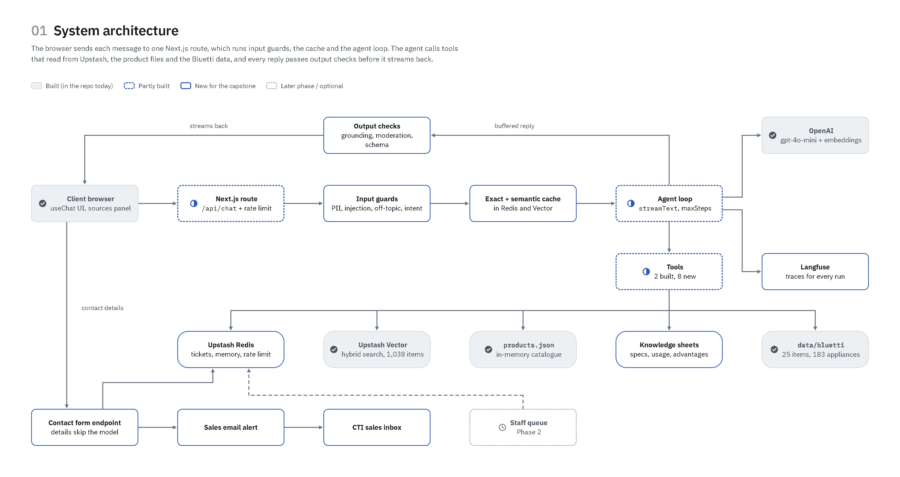

# CTI Product Advisor

CTI is a Philippine trading company. It sells about 1,000 items for workplace
safety, rescue and disaster, facilities and households. The CTI Product
Advisor is an agentic chat assistant for CTI clients. A client can ask:

- which items CTI sells
- the price of an item
- how two items are different
- which Bluetti power station can run their appliances

The advisor answers from CTI's own data and makes a draft quotation. It sends
each question that it cannot or must not answer to the CTI sales team.

This project is the capstone for the Generative AI & Agentic AI course. It
extends the Week 14 [CTI Product Assistant](https://github.com/cleogo/cti-product-assistant).
The Week 14 app is a tool-calling RAG chat over CTI's 1,038-item price
masterlist. It is live at https://cti-product-assistant.vercel.app.

## Origin

This repo is a clone of
[cleogo/cti-product-assistant](https://github.com/cleogo/cti-product-assistant)
at tag `week14-submission` (commit `02ea4e9`). The commits up to and including
`02ea4e9` are the Week 14 app. The commits after `02ea4e9` are the capstone
work. [`docs/week14-reference.md`](docs/week14-reference.md) gives more
information about the baseline.

> **Status (31 Oct 2026): in progress.** The Week 14 app runs from this repo.
> The Bluetti data and the catalogue-sheet data are clean and are in `data/`.
> Work continues on the new tools, guardrails, caching and evaluation. The
> submission date is Sun 15 Nov 2026. The capstone will have its own
> deployment. Its URL will go here.

---

## Features

| | Feature | State |
|---|---|---|
| F1 | Browse and search the catalogue by category, code, name or price | Built (Week 14) |
| F2 | Product details from a knowledge sheet: specs, usage and advantages | In progress |
| F3 | Side-by-side comparison of 2–4 products | In progress |
| F4 | Power-station recommender: appliance checklist → load and runtime calculation → the smallest sufficient Bluetti | In progress |
| F5 | Draft quotation, with VAT calculated backwards from VAT-inclusive prices | In progress |
| F9 | Escalation to sales for each question that the advisor cannot or must not answer | In progress |

[`docs/capstone-prd.md`](docs/capstone-prd.md) is the full specification. It
has an acceptance test for each feature. The plan also has extra features: an
updates sign-up, a staff quote queue, demo inventory and costing. These extras
are P1. Work on them starts only after the core evidence is
complete.

## How the advisor stays honest

The new tools obey the same rules as the Week 14 app.

- **The model does not calculate numbers.** Each price on screen comes from
  tool metadata, without changes. Code calculates the power-station load, the
  runtime, the quotation totals and the VAT. Unit tests check that code. The
  model explains the result. It does not do the arithmetic.
- **The masterlist is final.** Catalogue sheets and supplier data add specs.
  They never replace a masterlist code, name or price.
- **The advisor does not invent specs.** For an item without a knowledge
  sheet, the advisor gives the price, the code and an honest "not on file". It
  also offers to send the question to sales.
- **The advisor refuses to estimate.** Data about stock, lead time, discounts,
  delivery and warranty is not on file. The advisor tells the client this and
  refers the client to sales.
- **Five product codes have conflicting source data.** Each of these codes
  occurs at two prices. The advisor gives a warning and refers the client to
  sales. It does not select one of the two prices. See
  [`docs/data-quality-report.md`](docs/data-quality-report.md).
- **A quotation is a draft, not an order.** The advisor never places an order
  and never changes stock. CTI sales confirm every sale.

## Architecture



One Next.js route runs the input guards, the cache and the agent loop. The
agent loop is Vercel AI SDK `streamText` with tools. The tools read the
in-memory catalogue, Upstash Vector, the knowledge sheets and the Bluetti
data. Each reply must pass output checks before it streams to the client.
[`docs/diagrams/`](docs/diagrams/) has the other diagrams. These include the
recommender flow, the VAT calculation and the two-week plan.

**Why the AI SDK and not LangGraph:** The agent is one model with tools. The
evaluation harness imports the same prompt, tools and retrieval code that
production uses. PRD §7.4 gives the full reasons.

## Data

| Dataset | Size | Location |
|---|---|---|
| CTI price masterlist | 1,038 records, 12 departments, 37 categories | `corpus/`, [`data/cti-price-masterlist.pdf`](data/cti-price-masterlist.pdf) |
| Bluetti catalogue | 25 items: power stations, home batteries, solar panels | [`data/bluetti/`](data/bluetti/) |
| Appliance wattage table | 183 appliances, from CTI's sales calculator | `data/bluetti/appliances.csv` |
| Catalogue-sheet specs | 1,038 records, extracted with OCR from CTI's printed sheets | `data/catalogue-specs.*`, reviewed in [`docs/catalogue-sheet-review.md`](docs/catalogue-sheet-review.md) |

Scripts generate all files in `corpus/`, `data/bluetti/` and
`data/catalogue-specs.*`. To change these files, edit the inputs: `data/raw/`
and the masterlist spreadsheet. Then run the scripts again.

Each product record is one atomic product. Do not divide a record into smaller
chunks. If you divide a row, the name and the price can go into different
chunks. [`docs/corpus-design-decisions.md`](docs/corpus-design-decisions.md)
explains the design of the corpus and the retrieval.

## Stack

- **Next.js 15** (App Router), **TypeScript**, **Tailwind**, **Vercel AI SDK v4**
- **OpenAI** `gpt-4o-mini` for chat, `text-embedding-3-small` for embeddings
- **Upstash Vector** for retrieval
- Planned: **Upstash Redis** (session memory, escalation tickets, rate
  limits, exact cache), **Langfuse** (tracing), **RAGAS** (RAG evaluation)
- Deployment on **Vercel**

## Run it locally

```bash
npm install
cp .env.example .env.local   # add your own keys
npm run seed                 # embeds the corpus into your Upstash index
npm run dev
```

| Variable | Purpose |
|---|---|
| `OPENAI_API_KEY` | Chat completions and embeddings |
| `UPSTASH_VECTOR_REST_URL` | Your Upstash Vector index |
| `UPSTASH_VECTOR_REST_TOKEN` | Upstash Vector REST token |

Use your own Upstash index. `npm run seed` writes to the index that these
variables identify.

### Scripts

```bash
python scripts/build_corpus.py           # 1. masterlist xlsx -> corpus/
python scripts/build_pricelist_pdf.py    # 2. corpus -> PDF, writes page numbers back
python scripts/clean_bluetti.py          # data/raw/bluetti-* -> data/bluetti/
npx tsx scripts/query.ts "stethoscope"   # queries the vector store without the UI
npx tsx scripts/eval.ts                  # retrieval correctness, no model
npx tsx scripts/grade.ts                 # full grading harness with the real model
```

Run the two corpus stages in this order. Stage 2 writes the PDF page numbers
back into the corpus.

## Repo layout

```
app/                   chat UI and the /api/chat route
lib/                   prompt, tools, retrieval, in-memory catalogue, seed
corpus/                generated RAG corpus (products and hand-written guide docs)
data/
  raw/                 Bluetti inputs as CTI supplied them
  bluetti/             clean Bluetti products, appliances, solar limits
  catalogue-specs.*    specs extracted from the catalogue sheets
  cti-price-masterlist.pdf
scripts/               corpus, PDF, Bluetti and spec builders, eval and grade harnesses
docs/
  capstone-prd.md      the capstone specification
  diagrams/            architecture, flows, WBS and Gantt
  spec.md              Week 14 contracts that the app still satisfies
  week14/              the archived Week 14 plan and reflection
  week14-reference.md  where the Week 14 baseline is
```

## Limitations

- Only items with a knowledge sheet have specs, usage and advantages. The
  coverage is partial on purpose.
- The default wattages are typical values. Real appliances are different, so
  the client can enter the nameplate value.
- Seven Bluetti items do not have a CTI price on file yet.
- The advisor gives list prices and draft quotations. CTI sales confirm every
  sale.
- Staff-only material (the costing formula and cost data) is not in this repo
  and is not in the public advisor.
