# Capstone diagrams

These diagrams match docs/capstone-prd.md and render on GitHub.

## 1. System architecture

The browser sends each message to one Next.js route, which runs input guards, the cache and the agent loop. The agent calls tools that read from Upstash, the product files and the Bluetti data, and every reply passes output checks before it streams back.

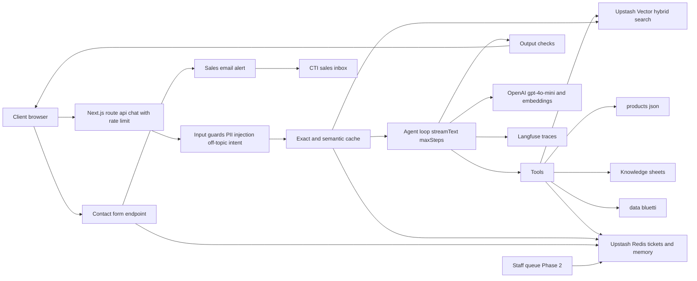

## 2. Request lifecycle

Each request passes the guards, then the cache, then the agent. Tool calls stream live, but the final text is held until the output checks pass, and a failed check gets one regeneration before the sales fallback.

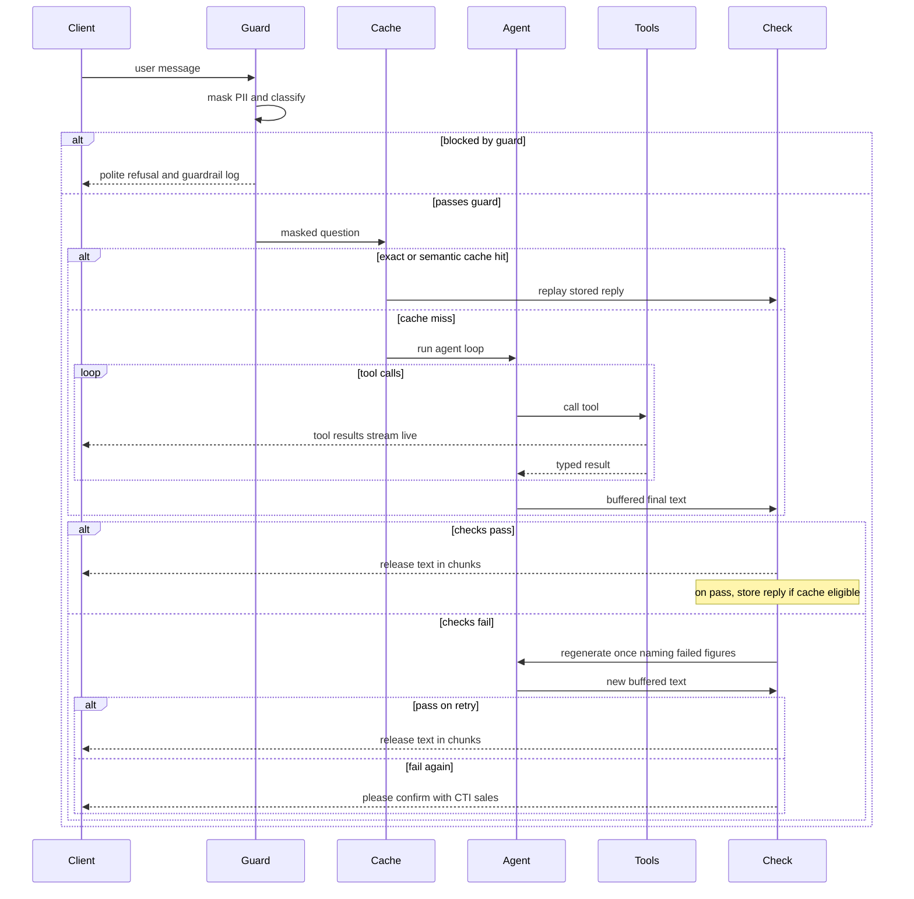

## 3. Tool routing

The model picks one tool per intent, and it asks a clarifying question before any tool call when the request is too vague. Each tool description names what belongs to another tool, so routing errors do not go unnoticed.

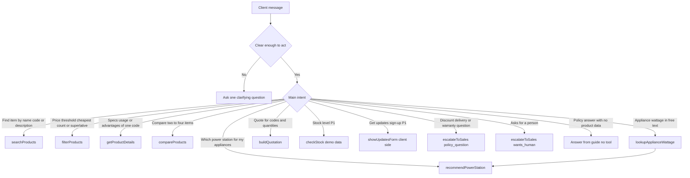

## 4. Data pipeline

Two paths feed the app. The masterlist is built into a corpus, rendered to a PDF with page numbers, then embedded into Upstash Vector. The Bluetti catalogue is cleaned into CSV files that the power-station tools read directly.

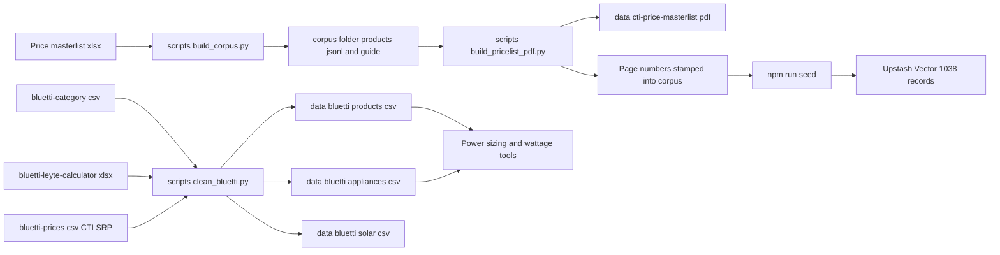

## 5. Power-station recommender

The recommender collects the appliance list, computes running load, energy and usable capacity, then keeps only stations that pass every rule. When nothing passes, the agent says so and offers a way forward rather than stretching the maths.

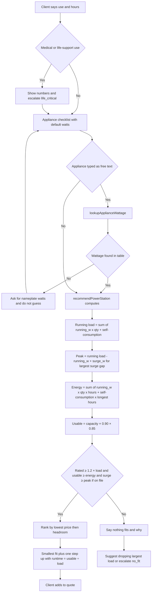

## 6. Quotation and VAT

The quotation tool builds every total itself. Prices are VAT-inclusive, so VAT is worked backwards from the total and never added on top, and the output is validated before the model sees it.

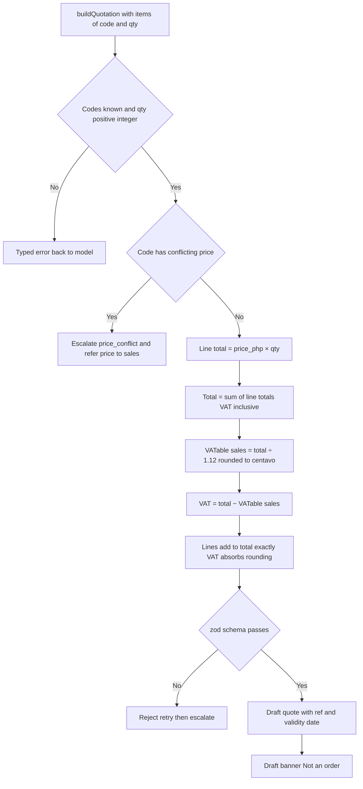

## 7. Escalation event (Phase 1)

A conflicted price code forces a ticket in code, and the agent's later soft triggers add reasons to that same ticket. The client's contact details go straight from the form to Redis and email, so the model never sees them.

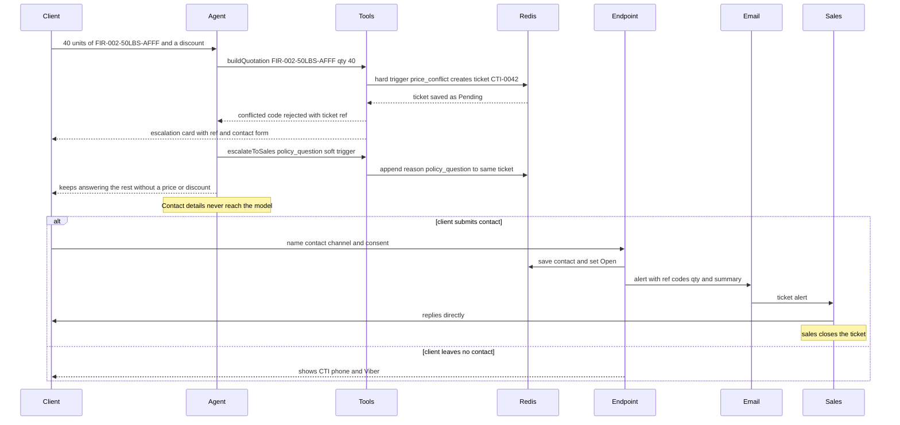

## 8. Escalation ticket states

A ticket is created once per session and stays Pending until the client submits contact details. Phase 2 adds a staff queue where the ticket is claimed and then resolved, while the email alert stays in place.

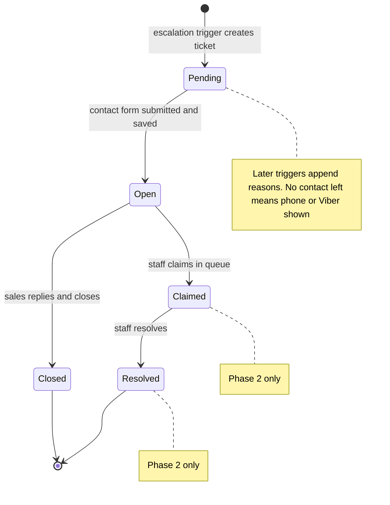

## 9. Caching decision

Four caches sit at different points: an exact reply cache for first-turn questions, a query embedding cache, a semantic cache that holds only policy answers, and a seed-time embedding cache. Every reply, cached or fresh, goes through the same output checks, and a catalogue rebuild changes the version that keys the exact and semantic caches.

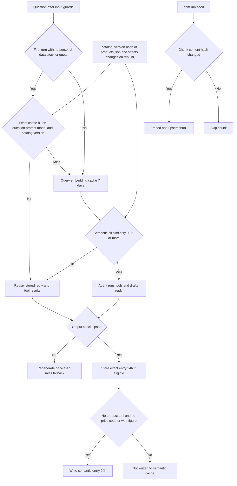

## 10. Evaluation loop

The RAG set and the scripted tool scenarios both run on the production prompt and tools, with every run traced in Langfuse. Each pass produces baseline numbers, one targeted change, and a re-run that reports before and after.

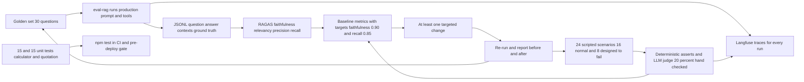

## 11. Deployment

The repo deploys from GitHub to Vercel, with secrets held only in Vercel settings and names matching the env example. The app reaches Upstash, OpenAI and Langfuse at runtime, and a Docker image reproduces it locally.

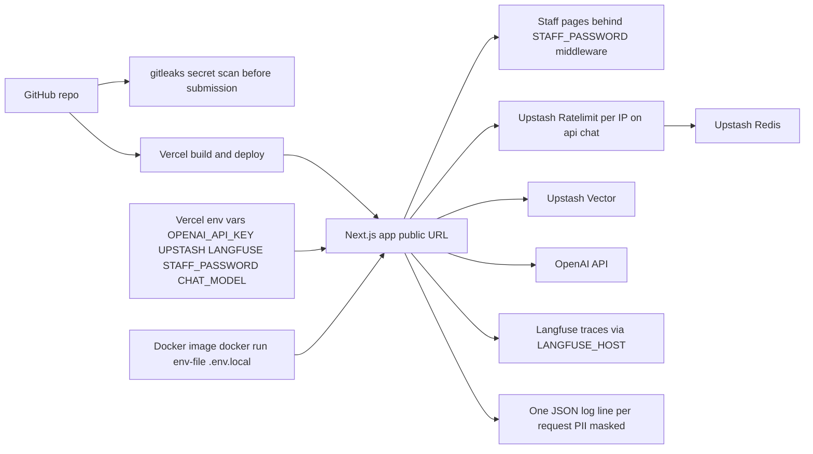

## 12. Scope tiers

Each tier is built only after the one before it has evidence in the repo. P0 is what the rubric scores, P1 is the MVP extras kept thin, and P2 waits on systems or data that are not ready yet.

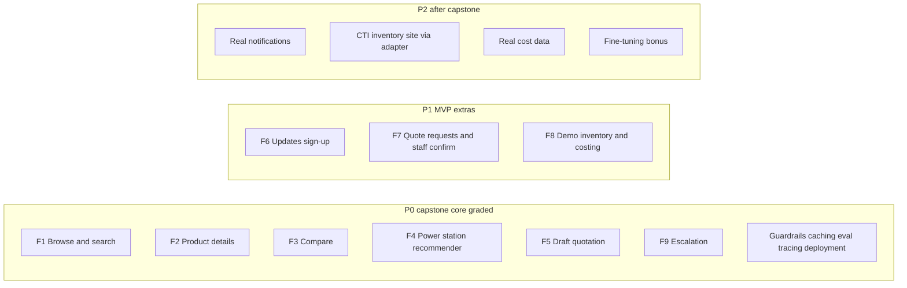
